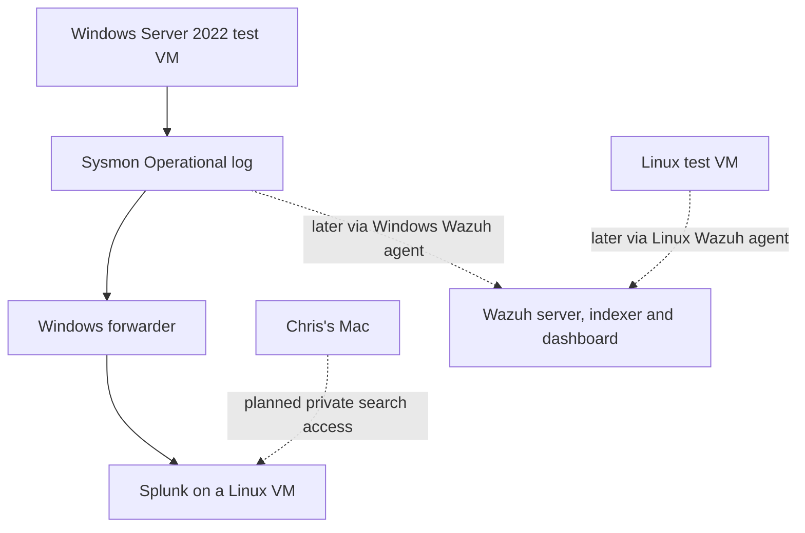

# TraceFoundry lab architecture

**Status:** Windows endpoint running. Sysmon collection and Splunk ingestion are planned.
**Owner:** Chris
**Reviewer:** Laura

Laura’s ThinkPad hosts the planned lab VMs in VMware. Chris’s M1 Mac is the workstation for Git, documentation, and Splunk searches. Host specifications, proposed VM allocations, tool versions, and recovery checkpoints are tracked in the [environment record](environment.md).

## Detection lab

The first milestone is to follow one Windows process from execution on the endpoint to a searchable event in Splunk. After the three Windows detections are tested in Splunk, Wazuh will collect the same endpoint activity independently so Chris and Laura can compare results.

| Component | Planned role | What still needs verification |
|---|---|---|
| Windows Server 2022 VM on Laura’s ThinkPad | Run controlled simulations and record process activity in `Microsoft-Windows-Sysmon/Operational` | Guest hostname, exact OS build, and Sysmon configuration |
| Splunk Linux VM on Laura’s ThinkPad | Receive Windows events, index them, and run SPL searches | Linux and Splunk versions, forwarding configuration, index, sourcetype, and timestamp handling |
| Chris’s Mac | Maintain the repository and reproduce Splunk searches | Private access method and successful login from the Mac |
| Wazuh and Linux test VMs | Compare Windows detection results and test file-integrity monitoring on Windows and Linux | Agent enrollment, collection settings, and paired test results in the later Wazuh phase |

## Network and recovery

The Windows Server 2022 guest uses VMware NAT. The route to Splunk and private access from the Mac are pending verification. Collector and dashboard access will be restricted to authorized lab users.

Laura created the `LAB-01 Clean Baseline` snapshot and reports a successful restore. Chris accepted the recovery result in issue #1.

## Isolated analysis environment

The later Ghidra and runtime analysis exercise will use a separate disposable VM. During execution, the VM will have internet egress and host-sharing features disabled and will have no route to the detection lab. Laura and Chris will verify isolation and snapshot recovery before running the exercise. After shutdown or rollback, they will export reviewed, sanitized evidence for the analysis report.

## First telemetry check

For [LAB-04](https://github.com/cnaraysingh05/tracefoundry/issues/4), launch `notepad.exe` in the Windows guest and locate its Sysmon Event ID 1 locally. Record the guest hostname, `UtcTime`, `Image`, and `ProcessGuid`. Search for that same event in Splunk and compare those values. Save the search and sanitized evidence so both Chris and Laura can reproduce the match.

## Architecture review

- [ ] Chris records the deployed VM names, versions, and network settings in the environment record.
- [ ] Laura confirms the diagram matches the deployed Windows and Splunk path.
- [ ] Chris and Laura verify the documented access and recovery steps.
- [ ] Chris links the reviewed evidence and updates the diagram wherever deployment differs from the plan.
