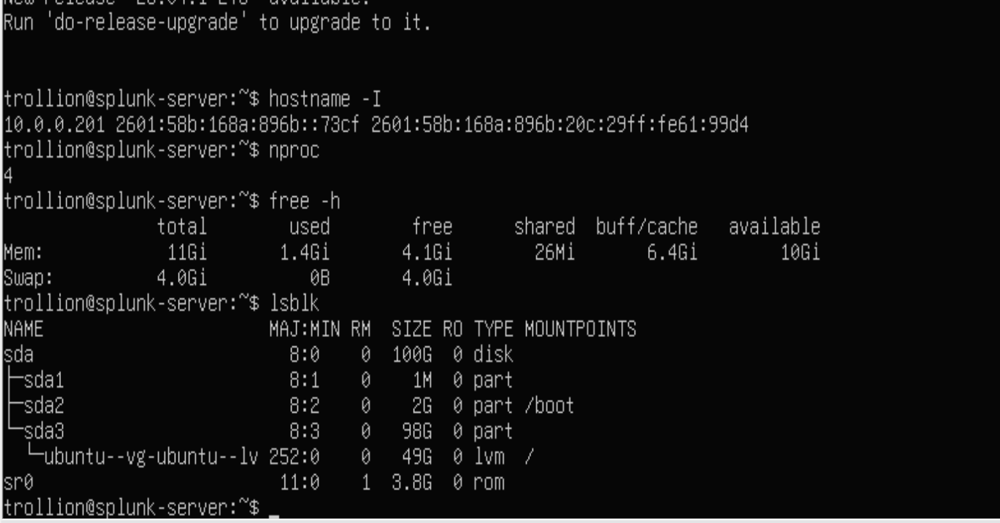
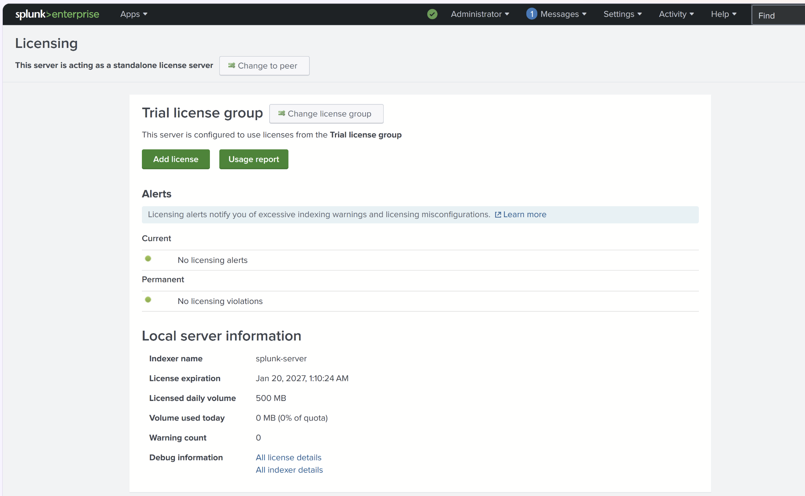
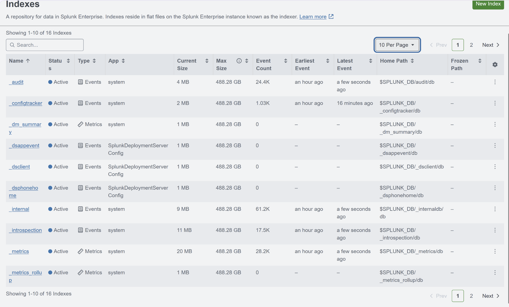
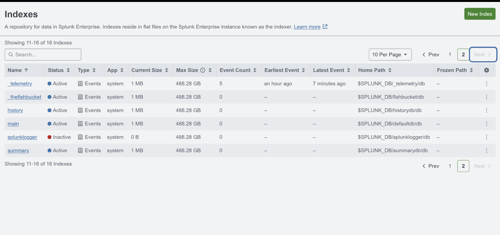

# LAB-03 — Splunk Enterprise installation and verification

**Project:** TraceFoundry  
**GitHub issue:** [#3 — LAB-03 Splunk installation](https://github.com/cnaraysingh05/tracefoundry/issues/3)  
**Implementation:** Laura; peer access verified with Chris  
**Status:** Splunk installed, operational, and jointly accessible. Time-based retention and Windows event ingestion have not yet been validated.

## 1. Purpose and scope

Deploy Splunk Enterprise on a supported, separate Linux collector VM hosted on Laura's Windows ThinkPad; document the installed versions, resource allocation, license, storage/index behavior, and authorized private access. The Windows/Sysmon-to-Splunk collection path is documented as **planned**, not implemented by LAB-03; ingestion verification belongs to LAB-04 / issue #4.

## 2. Deployed infrastructure

| Component | Observed configuration |
| --- | --- |
| Physical host | Lenovo ThinkPad, Windows host |
| Hypervisor | VMware Workstation (exact build not captured) |
| VM name | `TraceFoundry-Splunk` |
| Guest OS | Ubuntu Server 24.04.5 LTS, x86-64 |
| Guest hostname | `splunk-server` |
| Splunk Enterprise | 10.6.2.5 (seen in startup manifest) |
| VM processors | 4 logical processors (`nproc`) |
| Guest RAM | 11 GiB reported by `free -h` (nominal VMware allocation not separately recorded) |
| Swap | 4.0 GiB |
| Virtual disk | 100 GB (`sda`) |
| Partitioning | LVM; `sda2` 2 GB mounted on `/boot`, `sda3` 98 GB LVM partition, root LV approximately 49 GB mounted on `/` |
| VMware network | Bridged (same private Wi-Fi/LAN as the collaborator) |
| IPv4 at verification | `10.0.0.201` (DHCP/LAN address, may change) |
| Web UI | `http://10.0.0.201:8000` on the trusted local network |
| Splunk application path | `/opt/splunk` |
| Linux runtime account | `trollion` (non-root) |
| Service manager | systemd service `Splunkd` |

**Storage caveat:** The 100 GB virtual disk is not the same as 100 GB of free space available to Splunk. The root logical volume was approximately 49 GB at inspection. Actual filesystem free space and long-term capacity were not measured here.



## 3. Installation and service validation

- Installed Splunk Enterprise on the Ubuntu VM at `/opt/splunk`.
- Verified Splunk startup prerequisites and that the web server became available on TCP port `8000`.
- Confirmed successful Splunk administrator login from the Windows ThinkPad.
- Configured systemd boot-start to run as the unprivileged Linux account `trollion`, rather than root.
- Verified `systemctl is-enabled Splunkd` returned `enabled`, `systemctl is-active Splunkd` returned `active`, and `systemctl show Splunkd -p User` returned `User=trollion`.
- Rebooted Ubuntu, then confirmed the Splunk service became `active` again without manually starting it.

Useful repeatable **read-only** checks:

```bash
/opt/splunk/bin/splunk version
systemctl is-enabled Splunkd
systemctl is-active Splunkd
systemctl show Splunkd -p User
hostname -I
nproc
free -h
lsblk
```

## 4. License

The Splunk Web **Settings → Licensing** screenshot establishes:

| Item | Observed value |
| --- | --- |
| License server | Standalone |
| License group | Trial |
| Daily licensed ingestion | **500 MB** |
| Expiration | **January 20, 2027 at 1:10:24 AM** (UI timezone not established) |
| Ingested on screenshot date | 0 MB (0% of daily quota) |
| Warning count | 0 |
| Licensing alerts/violations | None shown |
| Indexer name | `splunk-server` |

The trial's 500 MB/day ingestion allowance is **not** a 500 MB index storage limit. Review licensing before the expiration date and before collecting higher-volume telemetry.



## 5. Index inventory and retention

At inspection, Splunk Web showed **16 indexes**, with 15 marked active and `splunklogger` marked inactive. Indexes and states as displayed:

| Index | State | Type | Events at capture |
| --- | --- | --- | ---: |
| `_audit` | Active | Events | 24.4K |
| `_configtracker` | Active | Events | 1.03K |
| `_dm_summary` | Active | Metrics | 0 |
| `_dsappevent` | Active | Events | 0 |
| `_dsclient` | Active | Events | 0 |
| `_dsphonehome` | Active | Events | 0 |
| `_internal` | Active | Events | 61.2K |
| `_introspection` | Active | Events | 17.5K |
| `_metrics` | Active | Metrics | 28.2K |
| `_metrics_rollup` | Active | Metrics | 0 |
| `_telemetry` | Active | Events | 5 |
| `_thefishbucket` | Active | Events | 0 |
| `history` | Active | Events | 0 |
| `main` | Active | Events | 0 |
| `splunklogger` | **Inactive** | Events | 0 |
| `summary` | Active | Events | 0 |

The index listing displays **488.28 GB** under **Max Size** for each listed index. This is a displayed configuration limit, **not** the actual free disk space and **not** a time-based retention setting. The screenshots do **not** establish `frozenTimePeriodInSecs`, other effective index limits, or a verified retention duration.

**Retention verification outstanding:** Inspect the effective configuration for the target Windows/Sysmon index (and `main` if it will be used), including time-based retention and storage thresholds. Record the applicable setting and whether it is default or explicitly configured before treating the retention acceptance criterion as fully verified. For example, inspect effective settings via Splunk's `btool` or the individual index settings screen. Keep future disk use within the VM's actual filesystem capacity.

The nonzero `_internal` and related counts demonstrate Splunk-generated operational telemetry. The `main` index contained **0 events** in the screenshot; **Windows/Sysmon ingestion is not yet demonstrated**.





## 6. Private access and collaboration

- The Splunk VM uses VMware **Bridged** networking on a trusted local Wi-Fi network.
- Splunk Web was reachable from Laura's Windows host at `http://10.0.0.201:8000`.
- A separate Splunk user account was created for Chris; Chris **successfully logged in from his own laptop on the same Wi-Fi**.
- No public port forwarding or remote VPN was needed for this local collaboration test.
- The private IP may change on another network or after DHCP reassignment. The VM and Splunk service must be running for access.
- Bridged networking can expose the Splunk login interface to other devices on that LAN. Use only a trusted network, strong individual credentials, and firewall restrictions appropriate to the lab. Do not publish credentials or expose TCP 8000 to the public internet.
- Access from a different network has **not** been tested or configured.

## 7. Collection path (planned; LAB-04)

```text
Windows Server detection VM (Sysmon + Windows Event Log)
                 |
                 | Splunk Universal Forwarder [planned; not yet validated]
                 v
Ubuntu Splunk Enterprise collector (splunk-server)
                 |
                 v
Splunk search, index, and detection content
```

**Status:** Windows-to-Splunk forwarding, receiver port, sourcetypes, event field mapping, timestamp alignment, and successful lookup of Sysmon Event ID 1 remain **pending** and must be verified under LAB-04 / issue #4. A working Splunk Web UI alone does not prove the ingestion pipeline is working.

## 8. Verification checklist and open items

- [x] Separate x86-64 Ubuntu Splunk collector VM deployed
- [x] Splunk version and VM resources recorded
- [x] Splunk starts under systemd with non-root account
- [x] Restart/reboot persistence tested
- [x] Splunk Web accessible to Laura
- [x] Separate account and same-LAN access successfully tested by Chris
- [x] License type, allowance, and expiration recorded
- [x] Index inventory and displayed max-size limits recorded
- [ ] **Record effective retention duration / storage thresholds for the intended collection index**
- [ ] Windows/Sysmon collection path configured and tested (**LAB-04**, not a prerequisite for installing Splunk)

**Security:** Do not commit passwords, Splunk authentication files, secret tokens, license keys, host identifiers unique to a personal account, or public internet exposure instructions. Screenshots supplied here show application settings and generic VM resources only.

## 9. Evidence

- [VM CPU, RAM, disk, IP](lab-03-vm-resources.png)
- [Splunk license page](lab-03-licensing.png)
- [Indexes page 1](lab-03-indexes-1.png)
- [Indexes page 2](lab-03-indexes-2.png)
- Peer verification: Chris successfully logged in on the same LAN (observed by collaborators; no screenshot attached).
